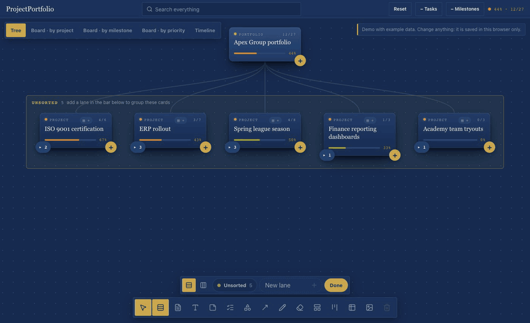
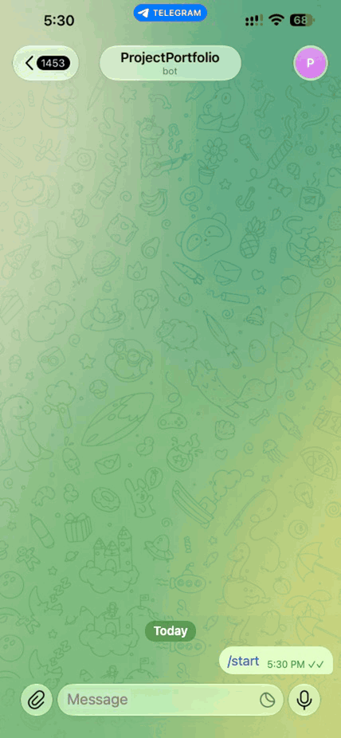
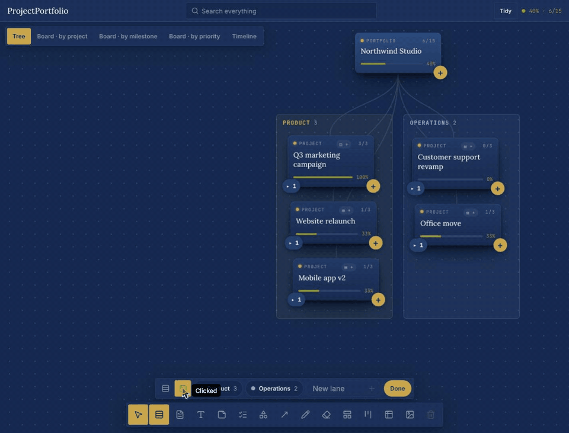
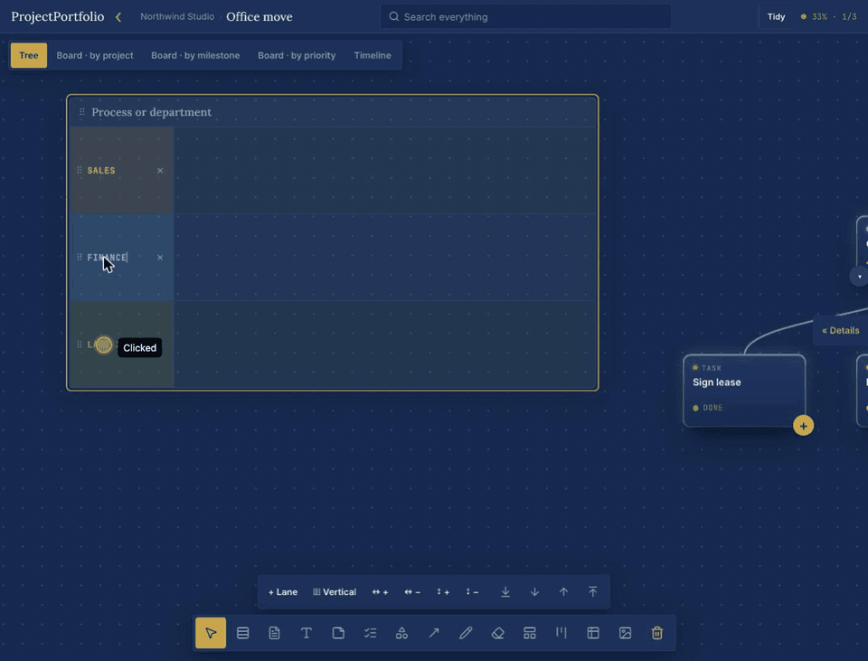
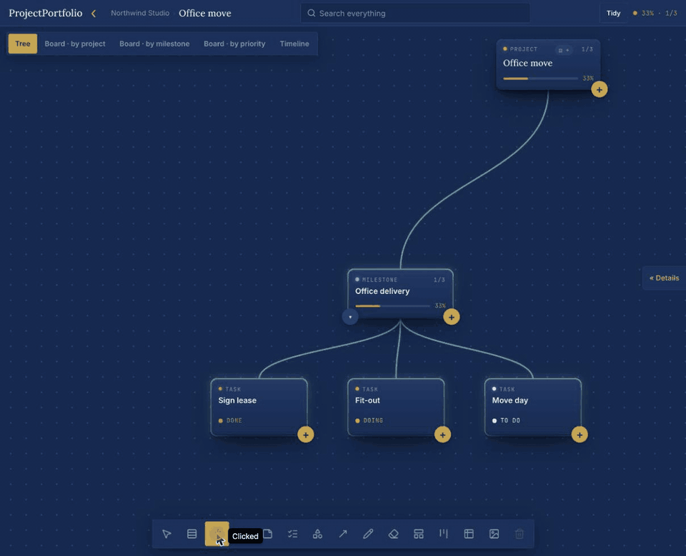
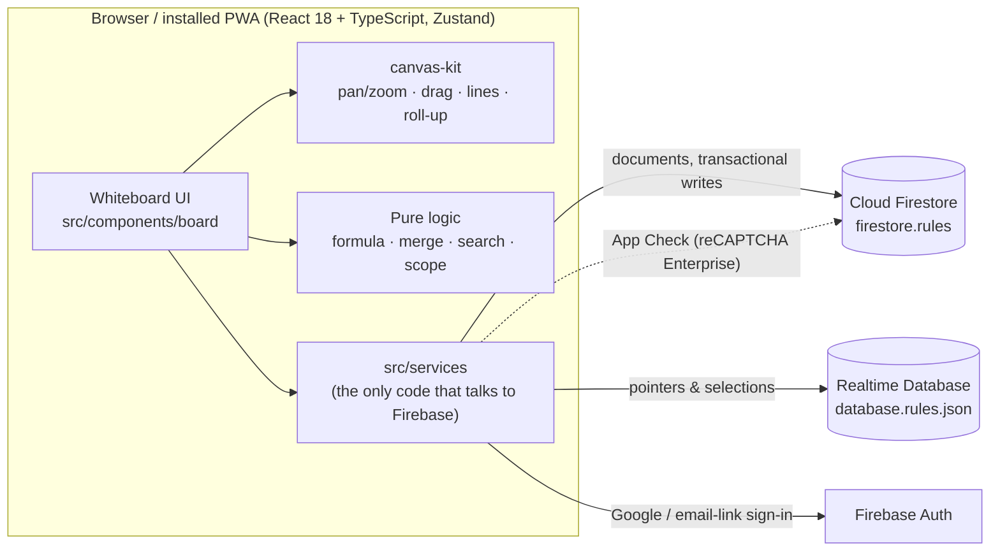

# ProjectPortfolio

**A mobile-first, real-time collaborative whiteboard for breaking projects down into work, without losing the picture.**

Cards are the work breakdown (portfolio → project → milestone → task). Around them sits a free-form board of notes,
tables, pages, checklists, shapes, arrows, ink and kanban boards. Progress rolls up the tree by itself, teammates see
each other's pointers live, and a person can be confined to just the branch of the project they work on.

**Live:** https://projectportfolio.nyanlinthu.com &nbsp;·&nbsp; [](https://github.com/nyanlinthu/projectportfolio/actions/workflows/ci.yml) [](https://github.com/nyanlinthu/projectportfolio/actions/workflows/codeql.yml)



## Why I built this

If you manage projects or portfolios of projects, this repo might feel like home for you. The pains that prompted me to build this:

- Operations teams' progress can't be seen unless someone asks the department head or manager for a report, and
  that invites surprises for management.
- Yet operations teams can't realistically update a Microsoft Project plan to report their progress.
- That leads to Notion, Trello, Jira or Asana. Then you still need whiteboards, process flows and swimlanes, which
  leads to draw.io or Lucidchart. We kept adding tools until the information was no longer in one place.
- And I always wanted a graphical work breakdown structure to interact with: a WBS everyone can see, not one that
  lives only in the PM's head.

So I built ProjectPortfolio to solve these problems. All the tools are in one place, and it's intuitive for
operations teams to mark their tasks "Done", which rolls up to the milestone, project and portfolio by itself.
Chartering a project is as easy as clicking the Plus button on a node: every new project starts with its charter.

It's MCP-ready (Model Context Protocol). Self-host it, and your own AI agent (Hermes, Claude Code or Codex) can
update tasks, fill in the charter, tell you where the project is stuck, or tweak it however you like. See
[`agent/`](agent/README.md).



I'm giving it back to the project-management community, for anyone with the same problem to use with their team.
Clone it and run it yourself, or use the hosted version at
[projectportfolio.nyanlinthu.com](https://projectportfolio.nyanlinthu.com), which is free. If its running costs ever
become significant, I may charge for the hosted version to cover them. The code stays free to use under the license below.

---

## What it does

| Area | What a user gets |
|---|---|
| **Whiteboard** | Pan/zoom canvas; cards stay exactly where you drop them. Double-tap a card to open a board *inside* it, nested as deep as you like. |
| **Work breakdown** | The card tree *is* the WBS, and its dates are the schedule. Progress is never typed in: it is derived from the leaves and rolled up. |
| **Views** | The same cards by status, or by priority as an Eisenhower matrix. One board component draws any axis. |
| **Swimlanes** | Group any card's children into lanes (rows or columns), and draw process flows on swimlane boards you place yourself. See below. |
| **Tables & pages** | 16 Notion-style property types, `=formulas` with cell references (`PROGRESS()`, `TASKS()`, `DONE()`…). Every row is a page with `@` mentions and backlinks. |
| **Project plans** | PMBOK knowledge-area templates (risk register with a probability × impact matrix, stakeholders, communications, quality…), generated per project. |
| **Together** | Live pointers, a coloured ring around what each teammate has selected or is typing in, and @mention notifications. |
| **Access** | Owner / manager / operator roles. An operator may only move the status of tasks assigned to them. Any member can be scoped to specific cards. |
| **Search & agent seam** | One index over every card and element. The same operations are exposed as Anthropic tool-use definitions on `window.projectportfolio`. |

### Swimlanes

Two things share the name, and they are separate on purpose:

- **Lanes for your cards.** Under any open card (the portfolio, a project, a milestone), the children can sit in lanes:
  Esports and Corporate, or companies, departments and entities under a group. They run as horizontal bands or vertical
  columns. Drag a card into a lane and it snaps into place. Add, rename, reorder and remove lanes from the bar above the
  tools (removing a lane never deletes a card: they fall back to Unsorted). Lanes are on whenever the page loads; the
  Swimlanes button, second in the bottom toolbar, turns them off for that visit. Dated cards line up oldest to newest.
- **Swimlane boards you place.** A frame of lanes for drawing a process flow by department or team. Drop sticky notes,
  checklists, shapes and arrows on it; they travel with the board while you drag it, and deleting the board deletes
  what is on it. Drag the lines between lanes to resize them, and flip it between horizontal and vertical.


*Lanes for your cards: switch rows and columns, drag a card into another lane, add a lane.*


*A swimlane board: lanes renamed to departments, shapes joined by arrows, a checklist and a sticky note that move with the board.*


*Pages: writing with an `@` link to a task, and a page nested inside a page.*

Lane membership is only a `lane` label on each card, and the bands are drawn from it, so progress roll-up and access
rules are untouched.

## Run it from chat: the agent


Any MCP agent (Hermes, Claude Code, Codex) can run a workspace from a chat: move status, add projects, milestones,
tasks, notes, checklists, pages and swimlane workflows, fill in the project charter, link dependencies. Ask
*"where are we stuck?"* and it answers from computed facts (bottlenecks, the longest open dependency chain, blocked,
late and stale work), with a picture of the real board: the WBS tree, the timeline, the boards.

It runs the app's own tools against the workspace, so an agent can do exactly what that member could do in the app
and nothing more. Every change is logged and can be reverted. Setup and the security model: [`agent/`](agent/README.md).

<br clear="right">

## Architecture



**Why the data is split this way.** Firestore holds everything that must last. Live pointers go to the Realtime
Database, because sending pointer traffic through Firestore would use up the write quota within minutes. Only
`src/services/` imports Firebase, so the rest of the app is plain, testable TypeScript.

## The hard parts

- **The rules are the security boundary, not the UI.** The database is reachable directly over the public API,
  so `firestore.rules` enforces roles, card-level scopes, per-account workspace caps and payload shapes. They are
  covered by **205 emulator tests** (`npm run test:rules`), which run in CI on every push.
- **Card-level access without leaks.** Every stored item carries `anc` (its ancestor ids). A scoped person queries
  `anc array-contains-any scopes`. The rules check that anything new really sits under its claimed parent, so
  nobody can tag an item into someone else's project.
- **Concurrent edits.** `src/lib/merge.ts` is a pure three-way merge (per field, per table row/column/card), and
  writes go through transactions, so two people editing the same card at the same time are merged instead of one
  overwriting the other.
- **A formula engine** (`src/lib/formula.ts`) with references that are written by clicking cells while typing.
- **Progress is derived, never stored.** `canvas-kit/src/rollup.ts` computes weighted progress and at-risk state
  from the leaves up.

## Run it locally

Requires Node 20+.

```bash
git clone https://github.com/nyanlinthu/projectportfolio.git && cd projectportfolio
npm ci
npm run dev            # no config needed: runs as a single-browser board saved on this device
```

Checks:

```bash
npm test               # formula, merge and roll-up unit tests
npm run typecheck
npm run test:rules     # 205 security-rules tests (needs Java 17+ for the emulators)
```

To test sign-in, sharing and presence with no Firebase account, run the local emulators:

```bash
npx firebase-tools@13 emulators:start --only auth,firestore,database --project demo-projectportfolio
VITE_USE_EMULATORS=1 npx vite --port 3001     # in a second terminal
```

To point it at your own Firebase project, copy `.env.example` to `.env` and fill it in.

## Continuous integration

Every push runs, in parallel: a strict type-check, the unit tests, the security-rules suite against the Firestore
and Realtime Database emulators, a production build with a bundle-size budget, a full-history secret scan
(gitleaks), and a production dependency audit. CodeQL scans weekly and on every PR, and Dependabot keeps
dependencies current.

## Layout

```
src/components/board   whiteboard, cards, tables, pages, sheets
src/lib                pure logic (formula, merge, search, scope, views, pmkit), unit-tested
src/services           Firebase: auth, sync, presence, inbox, admin
src/ai/tools.ts        agent tool definitions over the same stores the UI uses
agent/                 MCP server: lets Hermes, Claude Code, Codex run a workspace (see agent/README.md)
canvas-kit/            the shared canvas engine (also used by other apps of mine)
firestore.rules        the access boundary, with test/rules.test.mjs
```

## License

[PolyForm Shield 1.0.0](LICENSE). Free to use, including inside your own team or business. You may not use it to
offer a product that competes with it, such as reselling or rehosting ProjectPortfolio. This is a source-available
license, not an OSI open-source license.
